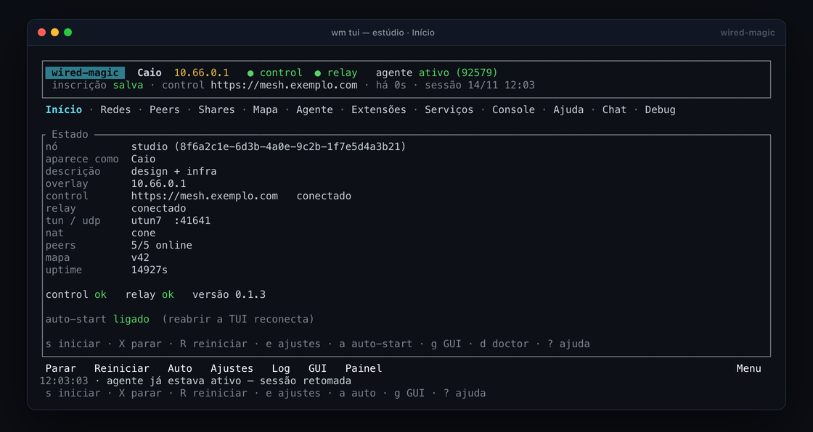
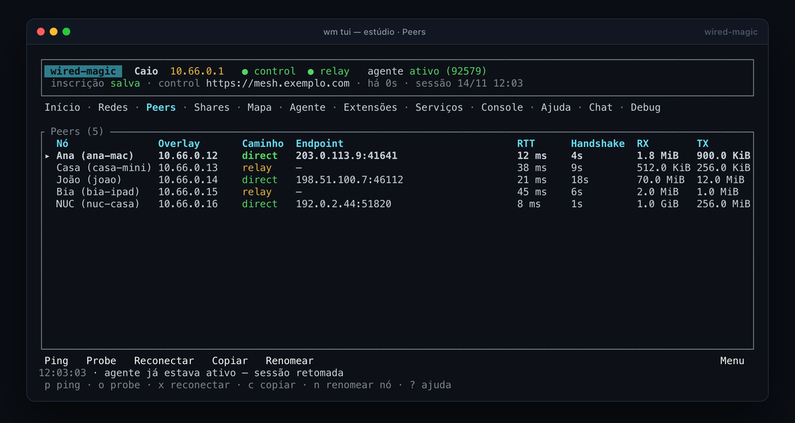
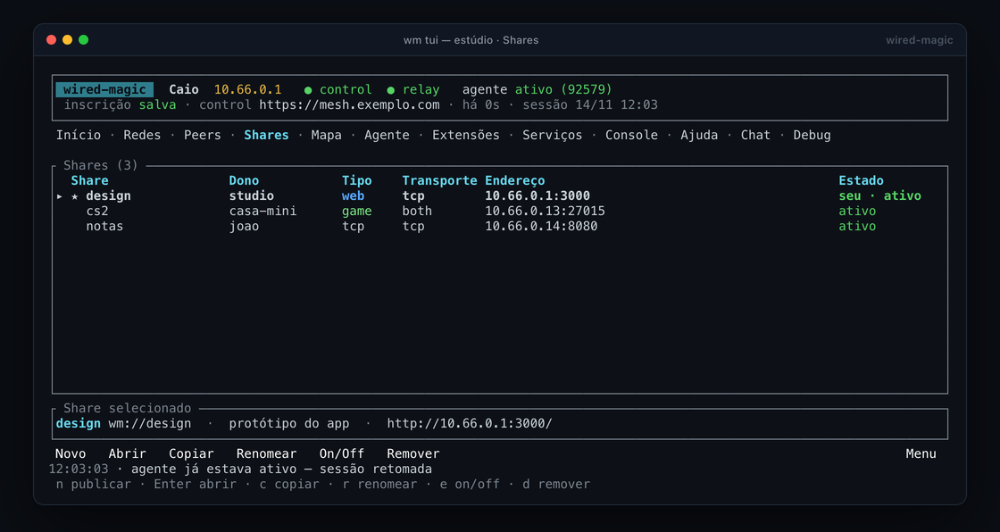
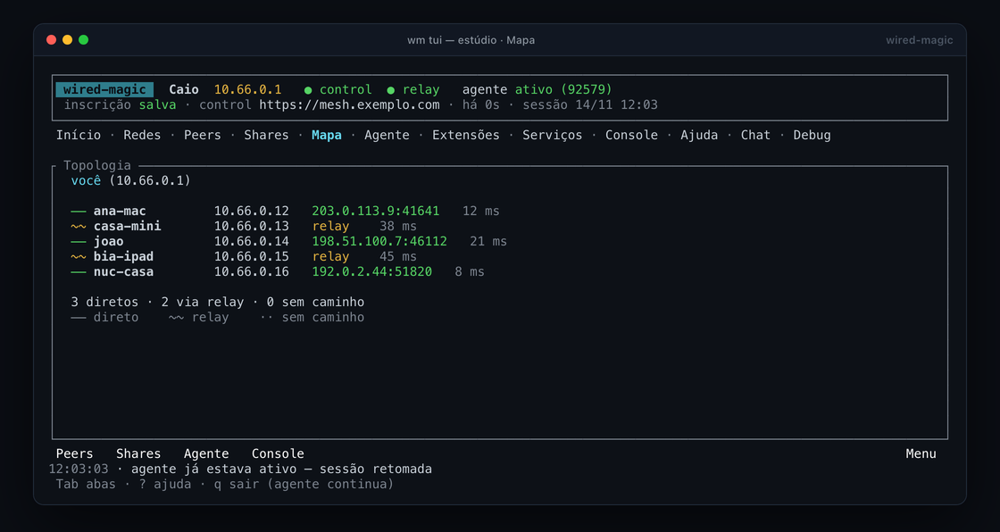
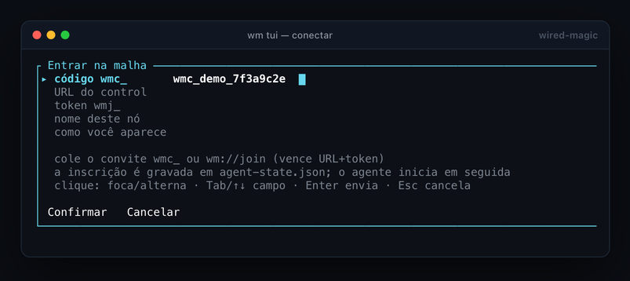
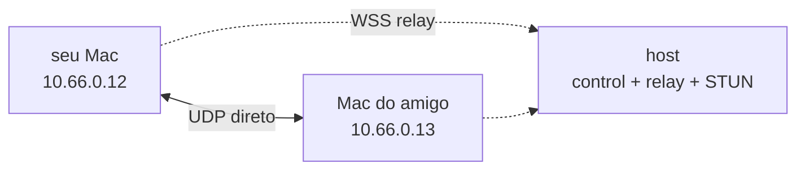

<p align="center">
  <picture>
    <source media="(prefers-color-scheme: dark)" srcset="docs/screenshots/logo-dark.png">
    
  </picture>
</p>

<h1 align="center">wired-magic</h1>

<p align="center">
  <strong>Sua rede privada em um comando.</strong><br>
  Dois computadores, um convite e nenhuma porta aberta no roteador de casa.
</p>

<p align="center"><sub>alpha · macOS e Linux · um binário</sub></p>

O wired-magic (`wm`) é uma VPN de malha: liga suas máquinas numa rede privada. Um computador
hospeda; os outros entram com um convite. A partir daí todos se enxergam como se estivessem no mesmo switch — e um
serviço rodando numa máquina vira `wm://nome` para a outra abrir.

O terminal é a casa. A TUI (`wm tui`) cuida de entrar na rede, subir o agente, mostrar quem está
online, publicar serviços e diagnosticar. Você quase não precisa decorar comando.

## A TUI é o painel

A TUI fala com o agente local. É o mesmo painel no Mac da sua mesa, no notebook e no host na VPS:
abas para o estado, peers, shares, mapa, agente, extensões, serviços e console.



*Início: seu nó, o IP fixo no overlay e o caminho de cada conexão. As teclas de cada tela ficam no
rodapé. `s` inicia o agente, `X` para, `?` abre a ajuda.*
<br>



*Peers: quem está online, se o caminho é `direct` ou `relay`, RTT e tráfego. `p` pinga, `o` testa
uma porta, `c` copia o IP do overlay.*
<br>



*Shares: o que está publicado na malha. `Enter` abre, `n` publica um serviço novo, `e` liga ou
desliga. O endereço é sempre o IP do overlay — não uma porta exposta na internet.*
<br>



*Mapa: linhas cheias são conexões diretas; as tracejadas caíram para o relay. A troca é automática
e não derruba o que já está conectado.*
<br>

<p align="center">
  
</p>

*Entrar na malha: `j` na aba Início abre o formulário. Cole o código `wmc_...` do convite e pronto
— ou informe a URL do host e o token `wmj_...`.*

> Capturas com dados de demonstração: nomes, IPs e domínio são fictícios.

## Para que serve

- **Mostrar um app sem deploy.** `sudo wm share 3000 --name design` publica o que está rodando na
  sua máquina; o amigo abre pela TUI (**Shares → design → Enter**) ou com `wm open design`.
- **Jogar junto.** CS2, Valheim, qualquer servidor LAN: publique com `--kind game` e jogue pelo
  IP do overlay, como se estivessem no mesmo cabo.
- **Voltar para casa.** Abra SSH ou a área de trabalho remota do computador de casa pelo IP fixo
  `10.66.0.x`, de qualquer lugar.
- **Um estúdio ou time pequeno.** Um host na VPS e os notebooks e servidores na malha; a ACL
  decide quem fala com quem.
- **Mais de uma rede.** Perfis separados (trabalho, amigos, clientes) na mesma máquina, cada um
  com seu agente e sua identidade.

## Como funciona

1. **Um nó hospeda.** `wm host` sobe o control plane, o relay, o STUN e o nó `.1` num comando. É o
   único lugar que precisa de endereço público.
2. **Os outros entram com um convite.** Cada nó cria um TUN, recebe um IP fixo no overlay
   (`10.66.0.0/24`, host `.1`, peers `.2`–`.254`) e fala WireGuard.
3. **O caminho se resolve sozinho.** Os peers tentam UDP direto (hole punching). Se não abrir em
   ~5 s, o mesmo tráfego segue cifrado por WebSocket no relay. A cada 30 s o wm tenta voltar ao
   caminho direto — sem derrubar a sessão.
4. **O host não lê o tráfego.** WireGuard é ponta a ponta: o relay só vê pacotes cifrados. Se o
   control cair, os túneis que já existem continuam de pé.
5. **Serviços ganham nome.** Um share é um nome (`wm://design`) que aponta para IP do overlay +
   porta. A ACL é aplicada na origem e no destino.



## Conectar com seu amigo

São dois papéis: um hospeda, o outro entra. Só o host precisa estar acessível da internet; os nós
só fazem conexões de saída. Na mesma casa, o host pode ser o próprio Mac; fora dela, use uma VPS —
o caminho mais curto é o [deploy de um compose no Coolify](docs/DEPLOY-COOLIFY.md).

### 1. Quem hospeda sobe o host

```sh
sudo wm host --public-url https://mesh.seudominio.com
```

Antes do primeiro start, configure `WM_BOOTSTRAP_USERNAME` e `WM_BOOTSTRAP_PASSWORD`
(ou `WM_BOOTSTRAP_PASSWORD_FILE`) no ambiente do serviço. Nenhuma senha é impressa.
Pela sua TUI, acesse `wm admin --server https://mesh.seudominio.com tui`, entre com essa
credencial temporária e crie **admin definitivo + usuário cotidiano**. O bootstrap é
invalidado permanentemente; remova as variáveis após concluir. Veja [primeiro acesso](docs/remote-admin.md).

Só após o setup o host inscreve o gateway e imprime um convite de instalação e um
**código `wmc_...` de uso único**. Mande o código **ou** o comando `curl`, não os dois.
Administre pela TUI/CLI. O [painel React](docs/control-panel.md) é uma extensão opcional,
instalada e ativada depois, não uma dependência do servidor nem do build padrão.

> O host precisa de TLS na frente (Caddy, proxy do Coolify ou `--tls-cert`/`--tls-key`). Para
> LAN/dev, `--listen 0.0.0.0:8080 --public-url http://192.168.0.10:8080` funciona, mas não
> exponha isso na internet.
> A receita completa está no [technical.md](technical.md#hospedar).

### 2. Seu amigo instala o `wm`

No macOS:

```sh
brew tap CaioFaSoares/tap
brew install CaioFaSoares/tap/wired-magic
```

No Linux, o host pode mandar um comando que baixa o binário, instala e já entra:

```sh
curl -fsSL https://mesh.seudominio.com/j/wmj_... | sh
```

Esse comando já inscreve a máquina e instala o serviço; se usá-lo, pule para o passo 4. Se o host
não publica o binário da arquitetura do seu amigo, compile no alvo ou use um binário de `dist/` —
os detalhes estão no [technical.md](technical.md#instalar-e-compilar).

### 3. Ele entra pela TUI

```sh
sudo wm tui
```

Na aba **Início**, aperte `j`, cole o código `wmc_...` do convite e dê Enter. A TUI inscreve a
máquina, sobe o agente e mantém a conexão mesmo depois de fechar com `q`.

**macOS, nó root já inscrito:** reabra com `wm tui`, **sem sudo**. Se o canal autorizado ainda não existir, `s` solicita autorização nativa para instalar o helper; depois, `q` fecha somente a interface e a próxima abertura reconecta. O diálogo pode pedir senha; Touch ID não é garantido. Enrollment inicial e perfis privilegiados adicionais ainda não fazem parte desse fluxo. Consulte [autorização desktop macOS](<docs/MACOS-DESKTOP.md>) para requisitos e limitações.

Sem código `wmc_`? O mesmo formulário aceita a URL do host e um token `wmj_...` nos campos
seguintes. Pela linha de comando, o equivalente é:

```sh
sudo wm join --code wmc_...     # ou: sudo wm join https://mesh... --token wmj_...
```

### 4. Confirme que vocês se veem

Na TUI, **Início** mostra os peers online e **Peers** mostra o caminho. Pelo terminal:

```sh
sudo wm ping ana
sudo wm peers
```

Se aparecer `relay`, está funcionando igual: é o desvio quando o UDP direto não passa.

### 5. Compartilhe alguma coisa

```sh
# na máquina que tem o app rodando na porta 3000
sudo wm share 3000 --name design --kind web

# na máquina do amigo, pela TUI
# Shares → design → Enter
# ou pelo terminal:
sudo wm open design
```

Pronto: o app está no ar para o seu amigo, sem deploy e sem abrir porta no seu roteador.

## Instalar

| Onde | Como |
| --- | --- |
| **macOS 14+** | `brew tap CaioFaSoares/tap && brew install CaioFaSoares/tap/wired-magic` |
| **Linux** | convite de instalação, binário de `dist/` ou `cargo build --release -p wired-magic` |
| **VPS / Docker** | [`docker-compose.yml`](docker-compose.yml) no Coolify ou `wm host` — veja o [guia](docs/DEPLOY-COOLIFY.md) |
| **Windows** | não há cliente nativo; WSL2 é experimental (veja o [technical.md](technical.md#windows-via-wsl2-experimental)) |

O agente precisa de `root` para criar o TUN e as rotas. No macOS, a TUI instalada pelo Homebrew
se atualiza sozinha em segundo plano; `WM_NO_AUTO_UPDATE=1` desliga.

## No dia a dia

| Comando | O que faz |
| --- | --- |
| `sudo wm tui` | o painel principal: inscrição, agentes, peers, shares, mapa e console |
| `sudo wm status` / `sudo wm peers` | estado do nó e peers, com caminho e RTT |
| `sudo wm share 3000 --name design` | publica um serviço local na malha |
| `sudo wm open design` | abre um share web ou imprime o endereço |
| `sudo wm ping ana` / `sudo wm probe ana 22` | testa ICMP e uma porta TCP pelo overlay |
| `sudo wm gui` | a mesma visão num painel local no navegador |
| `sudo wm doctor` | diagnóstico de root, TUN, rota, control e socket |
| `sudo wm service install --mode agent` | sobe o agente no boot (systemd/launchd) |

Comandos locais conversam com o socket do agente, que pertence a `root`; por isso o `sudo`. Na
TUI, você já está dentro dele.

## Limites

- **Alpha.** É um POC operacional, não um produto auditado. Teste antes de confiar.
- **macOS e Linux nativos.** Sem Windows nativo, iOS/Android, exit node, subnet router, HA de
  control, multi-região de relay ou DNS do sistema. WSL2 é experimental.
- **Vários nós por máquina são possíveis, mas isolados.** Cada rede/perfil tem seu próprio
  agente, TUN e porta UDP; a TUI gerencia os perfis na aba **Redes**.
- **ACL aberta por padrão quando a política está vazia.** Configure antes de expor qualquer coisa.
- **O host é um ponto central de disponibilidade.** O relay é o fallback; o caminho direto depende
  de NAT/UDP e pode cair para relay de forma esperada.

## Técnico

Arquitetura, protocolo, portas, segurança, build, deploy, API, perfis, exigências por nó, testes
e a referência completa de comandos estão em **[technical.md](technical.md)**.

| Documento | Conteúdo |
| --- | --- |
| [ARCHITECTURE](docs/ARCHITECTURE.md) | componentes, mapa, data plane e relay |
| [SECURITY](docs/SECURITY.md) | modelo de ameaças, credenciais e ACL |
| [SHARES](docs/SHARES.md) | contrato de shares e `wm://` |
| [API](docs/API.md) | endpoints e formatos |
| [TROUBLESHOOTING](docs/TROUBLESHOOTING.md) | erros comuns e correções |
| [extensions](docs/extensions.md) | extensões, drivers e cloudflared |

Licença MIT.
