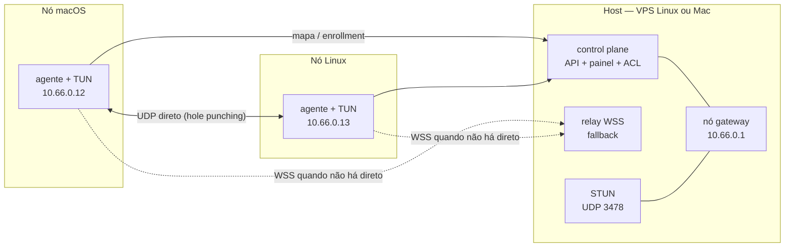

# wired-magic

Malha VPN self-hosted no espírito do Tailscale: **um nó hospeda**, qualquer outro entra com o
mesmo binário e todos passam a se ver numa rede overlay — sem abrir portas nos nós atrás de NAT.
Os pacotes vão **direto** entre os peers quando a rede permite e caem automaticamente para um
**relay** quando não permite; o control plane coordena, mas não fica no caminho dos dados.

> **Estado:** alpha operacional, candidato para testes locais. Funcionalidade implementada não
> significa cenário validado em produção. O [plano de prontidão](docs/PLANO-PRONTIDAO.md)
> organiza os gates de aceite, os cenários Seance/Macs/jogos e o que ainda falta antes de release.

> **Quer só hospedar?** O repositório tem `Dockerfile` e `docker-compose.yml` na raiz prontos
> para um único recurso Docker Compose no Coolify. O caminho completo está em
> [Deploy com Coolify](docs/DEPLOY-COOLIFY.md).



## macOS: Homebrew e atualizações sem interromper a TUI

O tap público é [CaioFaSoares/homebrew-tap](https://github.com/CaioFaSoares/homebrew-tap)
e a instalação é `brew tap CaioFaSoares/tap && brew install CaioFaSoares/tap/wired-magic`
(detalhes em [Homebrew](docs/homebrew.md)). A release `v0.1.0` já está publicada e a
fórmula está no tap; novas versões entram no tap pelo mesmo script. Os binários de
demonstração em `dist/` não são releases do tap. A publicação local não gasta minutos
do GitHub Actions; o workflow macOS é apenas um fallback manual.

```sh
git status                      # a árvore precisa estar limpa
scripts/publish_macos.sh --tag v0.1.0 --dry-run
# commit + git push, e então:
scripts/publish_macos.sh --tag v0.1.0
```

Ao abrir `wm tui` instalado pelo tap, a TUI verifica e instala versões estáveis mais
novas em segundo plano via Homebrew, com aviso no console/notificações. A sessão e o
agente continuam na versão atual; a nova versão entra na próxima abertura, sem reinício
forçado. Use `WM_NO_AUTO_UPDATE=1 wm tui` para desativar. Fórmulas fixadas com `brew pin`
são respeitadas. Sob `sudo`, a TUI apenas orienta atualizar como usuário normal: nunca
executa Homebrew como root. Builds locais e instalações fora do Homebrew não são alterados.

## O que você ganha

- **Um binário, todos os papéis.** `wm host` sobe control plane, relay, STUN e o nó local em um
  comando; `wm join` inscreve outro computador e sobe o agente.
- **Data plane direto ou por relay.** WireGuard em userspace (boringtun), TUN, rotas, keepalive,
  roaming e hole punching; se o UDP não passar, o mesmo tráfego segue cifrado por WSS.
- **Serviços por nome.** `wm share 3000 --name demo` publica um serviço local; outro nó abre por
  `wm://demo`, pela GUI ou pela TUI, sem abrir porta pública.
- **Administração web.** Painel React embutido no binário: nós, tokens, ACL, relay/STUN,
  integração, auditoria e extensões.
- **Ferramentas locais.** GUI (`wm gui`), TUI (`wm tui`), CLI e diagnóstico (`wm doctor`).
- **Integração somente leitura.** `GET /api/v1/integration/nodes` para o Seance e outros
  consumidores, autenticado por service token.

## Como funciona

1. O agente faz **STUN** pelo mesmo socket UDP que carrega WireGuard e publica o mapeamento NAT
   e os IPs LAN.
2. O control entrega os candidatos de cada peer no **mapa** versionado (long-poll de até 25 s).
3. O nó com menor caminho dispara handshakes WireGuard para os candidatos. Um pacote válido de
   volta fixa o endpoint e o caminho fica `direct`.
4. Sem handshake direto em ~5 s, os pacotes vão em frames binários pelo WebSocket `/relay`
   (TLS). O relay só vê ciphertext WireGuard; não decifra nem forja.
5. A cada 30 s o agente tenta voltar ao caminho direto. A sessão WireGuard é a mesma, então a
   troca não quebra conexões estabelecidas.
6. Control fora do ar **não derruba** túneis já estabelecidos. O mapa volta quando o control
   responde; o relay continua disponível para novos caminhos.

A ACL é aplicada na origem **e** no destino. O overlay padrão é `10.66.0.0/24` (configurável),
com host `.1`, peers `.2`–`.254` e MTU 1280; o endereço é estável, então serviços e regras não
dependem do IP público do nó. Nomes existem no mapa/CLI/API — não há DNS do sistema no v1. Os nós
só fazem conexões de saída; port forwarding não é necessário. Detalhes de implementação e decisões
estão em [ARCHITECTURE](docs/ARCHITECTURE.md), [RESEARCH](docs/RESEARCH.md) e
[SECURITY](docs/SECURITY.md).

## Plataformas

O v1 tem caminho nativo para **macOS** e **Linux**. Windows não é suportado nativamente nesta
versão: o agente depende de TUN, rotas do sistema e um socket Unix, e não existe build nem
serviço Windows. O caminho possível é **WSL2**, marcado como experimental.

| Plataforma | Host / control | Nó (`wm join`) | Serviço | Artefato publicado |
| --- | --- | --- | --- | --- |
| macOS 14+ Apple Silicon | sim | sim | launchd | `dist/wm-darwin-arm64` |
| macOS Intel | sim (compilar) | sim (compilar) | launchd | não |
| Linux x86_64 (glibc 2.34+) | sim (compilar) | sim (compilar) | systemd | não |
| Linux aarch64 (glibc 2.34+) | sim | sim | systemd | `dist/wm-linux-arm64` |
| Windows 10/11 nativo | não | não | não | — |
| WSL2 (Ubuntu) | experimental | experimental | systemd, se habilitado | binário Linux |
| Docker (Linux) / Coolify | sim (`wm host` ou `wm serve`) | experimental (TUN no container) | — | imagem do repo |
| iOS / Android | não | não | não | — |

- **“sim (compilar)”** significa que o código tem caminho para a plataforma, mas não há binário
  publicado neste workspace; compile no alvo (ou use a matriz de cross-compile abaixo).
- Os binários publicados são builds de demonstração, sem assinatura de distribuição nem
  notarização. No macOS, o binário pronto exige macOS 14+ (assinatura ad-hoc); no Linux,
  glibc 2.34+ (Ubuntu 22.04+, Debian 12+).
- **Windows nativo não é um caminho suportado.** Não há `.exe`; Git Bash/MSYS2 também não resolve,
  porque o agente usa TUN e socket Unix. Use WSL2 apenas se aceitar as limitações da seção
  [Windows via WSL2](#windows-via-wsl2-experimental).
- iOS/Android, exit node, subnet router, HA de control, multi-região de relay e DNS do sistema
  estão fora do v1. Veja [Limites do v1](#limites-do-v1).

## Pré-requisitos

| Recurso | Host | Nó |
| --- | --- | --- |
| `root` / `sudo` | sim, se o host também rodar o agente | sim, para TUN e rotas |
| TUN | `/dev/net/tun` no Linux; `utun` no macOS | igual |
| Portas de entrada | 443/tcp + 3478/udp; 41641/udp opcional | nenhuma |
| Saída | 443/tcp, 3478/udp, 41641/udp | 443/tcp, 3478/udp, 41641/udp |
| Dados | `/var/lib/wired-magic` (Linux) ou `/usr/local/var/wired-magic` (macOS) | mesmo caminho |

O caminho documentado para o agente é **root**, necessário para `/dev/net/tun` e para as rotas
(`ip`/`ifconfig`/`route`); não há um perfil rootless testado com capabilities. O control plane
pode rodar sem root quando escuta em porta > 1024 (por exemplo, `wm serve` em
`127.0.0.1:8080`). O `wm host` no modo padrão (com agente) precisa de root porque também sobe o
nó `.1`; `--no-agent` dispensa o TUN e pode rodar sem privilégios.

Variáveis úteis:

| Variável | Para quê |
| --- | --- |
| `WM_DATA_DIR` | atalho para `--data-dir` |
| `WM_PUBLIC_URL` | URL pública do host |
| `WM_ADMIN_PASSWORD` | senha inicial do admin (só no primeiro start) |
| `WM_LOG` / `--log` | nível de log (`info`, `debug`, `trace`) |

### Portas personalizadas no servidor

As portas padrão não são obrigatórias. Exemplo sem proxy (TLS terminado pelo próprio servidor):

```sh
sudo wm host --listen 0.0.0.0:8443 \
  --public-url https://mesh.exemplo.com:8443 \
  --tls-cert /etc/wired-magic/cert.pem --tls-key /etc/wired-magic/key.pem \
  --stun-listen 0.0.0.0:5349 --udp-port 51820
```

Libere **8443/tcp**, **5349/udp** e **51820/udp** no firewall. API, painel e relay
compartilham a porta HTTP/TLS. Com proxy reverso, use a URL/porta pública do proxy em
`--public-url`; a porta de `--listen` é interna. Os clientes recebem o endereço STUN
com a porta escolhida automaticamente. Se houver remapeamento UDP para outra porta
pública, anuncie-a com `--stun-url stun:mesh.exemplo.com:PORTA` (repetível).

`wm serve` também aceita `--listen`, `--stun-listen` e `--stun-url`; não tem agente
local, portanto não precisa de `--udp-port`. As variáveis `WM_LISTEN`,
`WM_STUN_LISTEN`, `WM_STUN_URLS` (lista separada por vírgulas) e, em `wm host`,
`WM_UDP_PORT` permitem configurar sem flags. No Docker Compose/Coolify, use
`WM_HTTP_PORT`, `WM_STUN_PORT` e `WM_UDP_PORT`, conforme o [guia de deploy](docs/DEPLOY-COOLIFY.md).
Alterações exigem reiniciar o servidor/recriar o container; não abrem o firewall automaticamente.

> **Uma máquina, um agente.** As rotas do overlay são da máquina inteira. Para simular dois nós
> no mesmo computador, use duas VMs/containers — não dois `wm join` no mesmo host.

## Hospedar com Coolify (um compose)

O caminho mais curto para uma VPS Linux é um único recurso **Docker Compose** no Coolify: a raiz
do repositório tem [`Dockerfile`](Dockerfile) e [`docker-compose.yml`](docker-compose.yml), e o
serviço `wm` sobe control plane, relay, STUN e o nó gateway `10.66.0.1` em um comando.

O Coolify cuida do TLS e do domínio do painel; o compose publica só as portas UDP que o proxy
HTTP não cobre. O nó gateway se inscreve sozinho no primeiro start — você só cria convites para
as outras máquinas. O guia detalhado, com backup, troubleshooting e limitações, está em
[Deploy com Coolify](docs/DEPLOY-COOLIFY.md).

**Pré-requisitos:** VPS Linux com Docker rootful + Coolify, domínio apontando para ela,
`/dev/net/tun` no host e as portas **443/tcp**, **3478/udp** e **41641/udp** liberadas. Não é
preciso abrir `8080/tcp`.

1. No Coolify: **+ New** → repositório → **Build pipeline: Docker Compose**.
2. Em **Base Directory**, use `/`; em **Docker Compose Location**, `/docker-compose.yml`.
3. Cadastre as variáveis:

   | Variável | Exemplo | Para quê |
   | --- | --- | --- |
   | `WM_PUBLIC_URL` | `https://mesh.exemplo.com` | URL pública **sem** `:8080`; vai nos convites e no relay |
   | `WM_ADMIN_PASSWORD` | senha longa e única | senha inicial do `admin` (só o primeiro start) |
   | `WM_NODE_NAME` | `gateway` | opcional; nome do nó `.1` no painel |

4. Em **Domains**, aponte o serviço `wm` para `https://mesh.exemplo.com:8080` (a porta é a
   interna do container; o acesso público continua em 443).
5. **Deploy**. O primeiro build compila Web + Rust e leva alguns minutos.
6. Abra o domínio, entre com `admin` + `WM_ADMIN_PASSWORD` e crie os convites em **Tokens**.
7. Nas máquinas, instale o binário e rode:

   ```sh
   sudo wm join https://mesh.exemplo.com --token wmj_... --name mac-01 --no-start
   sudo wm up
   sudo wm service install --mode agent
   ```

O nó do compose roda na rede bridge do Docker: ele participa da malha e os peers o alcançam em
`10.66.0.1`, mas a VPS em si não enxerga `10.66.0.0/24`. Se precisar que a própria VPS alcance
as máquinas, rode também um agente nativo no host — a receita está no
[guia do Coolify](docs/DEPLOY-COOLIFY.md#7-a-vps-como-nó-de-verdade-opcional).

> **Macs:** o convite `curl .../j/... | sh` só funciona se o host tiver o binário do cliente em
> `/data/control/dist`; o endpoint usa o próprio binário do container apenas quando o cliente é
> Linux da mesma arquitetura do host. Para Mac, instale `dist/wm-darwin-arm64` manualmente ou
> compile no alvo; o guia mostra como publicar o binário no volume.

## Instalar o binário

### Opção A — binário publicado neste workspace

Há dois binários de demonstração em [`dist/`](dist/): macOS Apple Silicon e Linux aarch64 (glibc).
Escolha o do seu sistema e confira o checksum. Em macOS Intel ou Linux x86_64 não há artefato
publicado; use a **Opção B** para compilar.

**macOS Apple Silicon**

```sh
cd dist
shasum -a 256 -c SHA256SUMS
xattr -d com.apple.quarantine wm-darwin-arm64 2>/dev/null || true
sudo install -m 0755 wm-darwin-arm64 /usr/local/bin/wm
cd ..
wm version
```

**Linux aarch64**

```sh
cd dist
sha256sum -c SHA256SUMS
sudo install -m 0755 wm-linux-arm64 /usr/local/bin/wm
cd ..
wm version
```

O binário macOS tem assinatura ad-hoc (necessária no Apple Silicon), mas **não tem Developer ID
nem notarização**. Em Terminal ele normalmente executa; se o macOS bloquear, use **Ajustes do
Sistema → Privacidade e Segurança → Abrir Mesmo Assim** ou compile localmente.

Em sistemas em que o `sudo` não herda o `PATH`, chame o caminho absoluto:
`sudo /usr/local/bin/wm status`.

### Opção B — compilar da fonte

Requisitos:

- Rust **1.94+** (`rust-version` do workspace) e um linker C (`Xcode Command Line Tools` no
  macOS; `build-essential` no Linux).
- Node.js **22 LTS** (mínimo 20.19) e **pnpm 10** para o painel.
- No Linux, `iproute2` (`ip`) em tempo de execução e `systemd` se for instalar o serviço.

```sh
# 1. painel (opcional para o CLI, mas necessário para o painel embutido atualizado)
cd web
pnpm install --frozen-lockfile
pnpm build
cd ..

# 2. binário (o rust-embed embute web/dist em tempo de compilação)
cargo build --release -p wired-magic

# 3. instale o binário final antes de instalar o serviço
sudo install -m 0755 target/release/wm /usr/local/bin/wm
wm version
```

O binário fica em `target/release/wm`. Se você mudar o frontend depois de compilar o Rust,
recompile o Rust: o painel é embutido no binário. Um build só do CLI pode usar o `web/dist` já
presente no repositório.

### Opção C — convite de um comando

Depois que o host estiver no ar, o próprio `wm host` imprime um comando como:

```sh
curl -fsSL https://mesh.exemplo.com/j/wmj_... | sh
```

Esse script:

1. detecta `uname -s`/`uname -m` (Linux ou macOS; amd64 ou arm64);
2. baixa `GET /download/wm?os=...&arch=...` do próprio host;
3. instala em `/usr/local/bin/wm` (com `sudo` se necessário);
4. roda `wm join --code ... --no-start`; e
5. instala o serviço do agente no systemd ou launchd.

O convite é de **um uso** e expira em ~1 h. Se preferir revisar antes de executar:

```sh
curl -fsSL https://mesh.exemplo.com/j/wmj_... -o wm-install.sh
less wm-install.sh
sh wm-install.sh
```

> **O host precisa ter o binário do cliente.** O endpoint `/download/wm` procura o diretório
> `dist` do **data dir do control**: no `wm host` isso é `<data-dir>/control/dist` (o control fica
> em `<data-dir>/control`); no `wm serve` é o próprio `--data-dir`. O host usa o próprio executável
> quando o cliente tem o mesmo SO/arquitetura, mas um VPS Linux **não** serve um binário macOS por
> mágica. Para frotas mistas, publique os binários como descrito em
> [Publicar binários para o convite](#publicar-binários-para-o-convite).

### Matriz de compilação

| Cliente | Triple Rust | Nome esperado no `dist` do control |
| --- | --- | --- |
| macOS Apple Silicon | `aarch64-apple-darwin` | `wm-macos-aarch64` |
| macOS Intel | `x86_64-apple-darwin` | `wm-macos-x86_64` |
| Linux x86_64 (glibc) | `x86_64-unknown-linux-gnu` | `wm-linux-x86_64` |
| Linux aarch64 (glibc) | `aarch64-unknown-linux-gnu` | `wm-linux-aarch64` |

A forma mais previsível é compilar numa máquina (ou runner) do alvo:

```sh
# no alvo Linux/macOS, com a toolchain nativa:
cargo build --release --locked -p wired-magic
```

Para Linux a partir de macOS (ou para x86_64 a partir de Apple Silicon), use Docker (com Docker
instalado); o alvo `make linux` já encapsula o build em container:

```sh
# Linux nativo (mesma arquitetura da máquina):
make linux

# x86_64 em uma máquina ARM:
docker run --rm --platform linux/amd64 \
  -v "$PWD":/src -w /src \
  -v "$PWD/.cargo-home":/cargo \
  -e CARGO_HOME=/cargo -e CARGO_TARGET_DIR=/src/target-linux \
  rust:1.98-bookworm cargo build --release -p wired-magic
```

O resultado fica em `target-linux/release/wm`. Para Linux com musl/Alpine, compile com o triple
`*-unknown-linux-musl` no ambiente correspondente; o binário glibc publicado não roda em musl.
Se a tag `rust:1.98-bookworm` não existir no seu registry, use a versão estável atual — o
workspace exige apenas 1.94+. Um Mac Intel também compila nativamente com o comando acima; não há
binário pronto para esse alvo neste workspace.

## Rodar o host

O host é o único lugar com endereço público. Ele concentra control plane, relay, STUN e,
por padrão, o nó `.1` (gateway). Use uma VPS Linux para produção; um Mac funciona para
laboratório, mas precisa ficar ligado e sem dormir.

### Linux (recomendado para VPS)

**1. Instale o binário** (Opção A/B/C acima) e confirme:

```sh
wm version
getent hosts mesh.exemplo.com     # DNS já aponta para a VPS?
```

**2. Faça o primeiro start em foreground** para capturar a senha do admin e testar o painel:

```sh
sudo mkdir -p /var/lib/wired-magic
sudo wm host \
  --public-url https://mesh.exemplo.com \
  --listen 127.0.0.1:8080 \
  --data-dir /var/lib/wired-magic
```

Saída esperada no primeiro start:

```text
  wired-magic — primeiro start
  painel:   https://mesh.exemplo.com
  usuário:  admin
  senha:    <gerada>          # anote agora; só o hash fica no SQLite

  malha pronta: https://mesh.exemplo.com
  painel:       https://mesh.exemplo.com

  convite de um comando (1 uso):
    curl -fsSL https://mesh.exemplo.com/j/wmj_... | sh

  convite manual (20 usos, 7 dias):
    wm join https://mesh.exemplo.com --token wmj_...
```

Deixe esse processo rodando só até validar; depois **pare com `Ctrl+C`** antes de instalar o
serviço (o serviço usa o mesmo data dir e o mesmo lock de rotas).

> O convite aponta para a `--public-url`. Se o Caddy/TLS ainda não estiver no ar, o `wm host`
> funciona, mas o `curl` do cliente não alcança o host; configure o proxy antes de testar o
> onboarding.

- `--public-url` é a URL que os clientes e o painel usam. Ela entra nos tokens de relay e no
  comando de convite; se estiver errada, troque-a antes de distribuir convites.
- `--listen 127.0.0.1:8080` deixa o TLS para o Caddy. Para TLS direto no `wm`, use
  `--listen 0.0.0.0:443 --tls-cert ... --tls-key ...`.
- `--approval-required` faz novos nós entrarem como `pending` até você aprovar no painel.
- `--tag`/`--label` do host são administrativos; o nó local recebe a tag `gateway`.
- `--expose 8421` publica um serviço local do próprio host no overlay (útil se o Seance roda na
  mesma VPS); a extensão Seance faz isso automaticamente em cada nó ativado.

**3. Coloque TLS na frente** (Caddy é o exemplo do repositório):

```caddyfile
mesh.exemplo.com {
    encode zstd gzip
    reverse_proxy 127.0.0.1:8080 {
        transport http {
            read_timeout 90s
            write_timeout 90s
        }
    }
}
```

O Caddy precisa repassar WebSocket em `/relay` e não pode bufferizar o long-poll/SSE do painel.
Os timeouts de 90 s existem por causa do mapa (25 s) e dos keepalives do SSE.

**4. Libere o firewall**:

| Porta | Protocolo | Para quê |
| --- | --- | --- |
| 443 | TCP | painel, API e relay WSS (pelo Caddy) |
| 3478 | UDP | STUN |
| 41641 | UDP | WireGuard/STUN dos nós (recomendada; entrada opcional) |

Sem IP público (ou port forwarding), clientes fora da LAN não alcançam o host: o control plane
precisa ser alcançável por HTTPS e o STUN por UDP para o caminho direto funcionar.

**5. Instale o serviço systemd**:

```sh
sudo wm service install --mode host \
  --public-url https://mesh.exemplo.com \
  --listen 127.0.0.1:8080 \
  --data-dir /var/lib/wired-magic

sudo wm service status --mode host
journalctl -u wired-magic-host -f
```

O gerador escreve `/etc/systemd/system/wired-magic-host.service` com os argumentos escapados e
**não** usa shell. As opções precisam ser repetidas no `service install`; ele não herda o
comando foreground anterior. Para mudar opções, remova e reinstale:

```sh
sudo wm service uninstall --mode host
# reinstale com as opções novas
```

**6. Verifique**:

```sh
curl -fsS https://mesh.exemplo.com/healthz
curl -fsS https://mesh.exemplo.com/api/v1/meta
sudo wm status
sudo wm peers
```

**Upgrade e backup:** pare o serviço, substitua `/usr/local/bin/wm`, reinicie; o estado em
`/var/lib/wired-magic` (incluindo `<data-dir>/control/control.db` e as chaves) é preservado.
Para backup, pare o serviço e copie o data dir inteiro; o SQLite e as chaves são sensíveis.
Mais receitas em [deploy/README.md](deploy/README.md) e [DEPLOY-VPS](docs/DEPLOY-VPS.md).

### macOS

O host em macOS é útil para laboratório e times pequenos, mas um Mac que dorme derruba a malha.
O fluxo é o mesmo, com data dir padrão diferente e launchd no lugar do systemd.

```sh
sudo wm host \
  --public-url https://mesh.exemplo.com \
  --listen 127.0.0.1:8080 \
  --data-dir /usr/local/var/wired-magic
```

Para o serviço:

```sh
sudo wm service install --mode host \
  --public-url https://mesh.exemplo.com \
  --listen 127.0.0.1:8080 \
  --data-dir /usr/local/var/wired-magic

sudo wm service status --mode host
sudo launchctl print system/com.wired-magic.host
sudo tail -f /var/log/wired-magic-host.log
```

- O launchd cria `/Library/LaunchDaemons/com.wired-magic.host.plist` e inicia como root no boot.
- O macOS pode pedir permissão de firewall para o binário; permita o `wm`.
- Evite `--listen 0.0.0.0:443` sem certificado; para produção, Caddy/Homebrew na frente.
- O TUN é `utun` e o número da interface é descoberto pelo agente; `wm status` mostra o nome real.

### Sem TLS (dev/LAN)

Use HTTP somente em loopback ou numa rede confiável. **Nunca exponha isso à internet.**

```sh
# terminal 1 — só control plane, sem TUN e sem root (porta > 1024)
wm serve --listen 127.0.0.1:8080 \
  --public-url http://127.0.0.1:8080 \
  --data-dir ./wm-data

# abra http://127.0.0.1:8080, faça login e crie um token em "Tokens"

# terminal 2 — um nó nesta máquina (root; um agente por máquina)
sudo wm join http://127.0.0.1:8080 --token wmj_... --name dev --no-start
sudo wm up
```

O `wm host` também aceita `--public-url http://127.0.0.1:8080`, mas ele já sobe o nó local e
precisa de root. Para apenas control/relay/STUN sem TUN, use `wm serve` ou
`wm host --no-agent`.

> **Não misture `wm host` e `wm serve` no mesmo data dir.** O `wm host` guarda o control em
> `<data-dir>/control`; o `wm serve` usa o data dir diretamente. Use diretórios separados para
> não criar dois bancos por acidente.

## Entrar como nó (clientes)

O `--name` precisa ser único na malha; sem ele, o hostname da máquina é usado. As **tags de ACL**
são definidas pelo administrador no convite/painel; `--tag` enviado pelo cliente não concede
autoridade. O `--token` vem de um convite manual; o `--code` (`wmc_...`) carrega URL e convite
juntos, então `sudo wm join --code wmc_...` é equivalente a informar URL + token.

### macOS (Apple Silicon ou Intel)

**1. Instale o binário.** Se o host já publica o binário certo, o convite de um comando resolve:

```sh
curl -fsSL https://mesh.exemplo.com/j/wmj_... | sh
```

Se o host não tiver o binário do seu Mac, baixe direto e instale:

```sh
arch=$(uname -m)   # arm64 no Apple Silicon, x86_64 no Intel
curl -fsSL "https://mesh.exemplo.com/download/wm?os=macos&arch=$arch" -o /tmp/wm
chmod 0755 /tmp/wm
sudo install -m 0755 /tmp/wm /usr/local/bin/wm
```

**2. Inscreva e teste em foreground:**

```sh
sudo wm join https://mesh.exemplo.com --token wmj_... --name mac-01 --no-start
sudo wm up
```

`Ctrl+C` para parar o teste. O estado fica em `/usr/local/var/wired-magic` por padrão; se usou
`--data-dir`, repita o mesmo caminho em todos os comandos seguintes.

**3. Instale o serviço:**

```sh
sudo wm service install --mode agent --data-dir /usr/local/var/wired-magic
sudo wm service status --mode agent
sudo tail -f /var/log/wired-magic-agent.log
```

O `service install` captura `--control`, `--tun-name`, `--force-relay`, `--udp-port`, `--mtu` e
`--expose`; repita ali qualquer opção que precise sobreviver ao boot. Ele não infere opções do
`join` foreground.

**4. Veja o nó e as ferramentas locais:**

```sh
sudo wm status
sudo wm peers
sudo wm doctor

# GUI local do membro (não é o painel de admin):
sudo wm gui --no-open      # abra a URL privada impressa no navegador
# ou, para abrir automaticamente:
sudo wm gui

# TUI:
sudo wm tui
```

A GUI/TUI falam com o socket Unix do agente, que é `0660` e normalmente pertence a root. Se o
agente roda como root, rode essas ferramentas como root (ou ajuste o grupo do socket de forma
consciente). O `--no-open` é útil em SSH ou quando o navegador não deve abrir como root.

### Linux

**1. Dependências de runtime:**

```sh
# Debian/Ubuntu
sudo apt update && sudo apt install -y iproute2 curl ca-certificates

# Fedora
sudo dnf install -y iproute curl

# Arch
sudo pacman -S --needed iproute2 curl
```

Confira o TUN:

```sh
ls -l /dev/net/tun
sudo modprobe tun     # se o módulo ainda não estiver carregado
```

Se `/dev/net/tun` não existir, o kernel/container não tem TUN; sem isso o agente não sobe.

**2. Instale o binário** (convite de um comando, download direto ou build local):

```sh
arch=$(uname -m)   # aarch64 em ARM64, x86_64 em Intel/AMD
curl -fsSL "https://mesh.exemplo.com/download/wm?os=linux&arch=$arch" -o /tmp/wm
chmod 0755 /tmp/wm
sudo install -m 0755 /tmp/wm /usr/local/bin/wm
```

Use `arch=x86_64` em máquinas Intel/AMD e `arch=aarch64` em ARM64. Se o host não servir esse
arquivo, compile no alvo e copie o binário.

**3. Inscreva e suba o agente:**

```sh
sudo wm join https://mesh.exemplo.com --token wmj_... --name linux-01 --no-start
sudo wm up                     # teste em foreground; Ctrl+C para parar
sudo wm service install --mode agent --data-dir /var/lib/wired-magic
sudo wm service status --mode agent
journalctl -u wired-magic-agent -f
```

Se a máquina não usa systemd (container, Alpine/OpenRC), rode `sudo wm up` em foreground ou
escreva a unit do seu init; `wm service install` só gera systemd no Linux.

**4. Exponha um serviço que escuta só em loopback** (se necessário):

```sh
sudo wm service uninstall --mode agent
sudo wm service install --mode agent --data-dir /var/lib/wired-magic --expose 8421
```

`--expose` precisa ser passado ao `service install`; a opção do `wm join`/`wm up` vale apenas para
aquela execução. Sem `--expose`, o serviço precisa escutar em `0.0.0.0` ou no IP do overlay.

### Windows via WSL2 (experimental)

Não existe cliente Windows nativo. O que funciona é executar o **binário Linux dentro do WSL2**;
não é uma plataforma suportada e não faz o Windows entrar na malha.

```powershell
# PowerShell como administrador
wsl --install -d Ubuntu-24.04
```

Dentro do Ubuntu:

```sh
sudo apt update && sudo apt install -y iproute2 curl ca-certificates
ls -l /dev/net/tun                 # se não existir, o TUN do WSL não está disponível

# systemd no WSL (necessário para `wm service install`)
sudo tee /etc/wsl.conf >/dev/null <<'EOF'
[boot]
systemd=true
EOF
```

No PowerShell: `wsl --shutdown`, reabra o Ubuntu e siga o fluxo Linux:

```sh
arch=$(uname -m)   # x86_64 ou aarch64
curl -fsSL "https://mesh.exemplo.com/download/wm?os=linux&arch=$arch" -o /tmp/wm
chmod 0755 /tmp/wm
sudo install -m 0755 /tmp/wm /usr/local/bin/wm

sudo wm join https://mesh.exemplo.com --token wmj_... --name win-wsl --no-start
sudo wm up                              # teste; Ctrl+C
sudo wm service install --mode agent --data-dir /var/lib/wired-magic
sudo wm gui --no-open                   # abra a URL impressa no navegador do Windows
```

Limitações que você precisa aceitar:

- **Somente processos dentro do WSL2** usam o overlay. Apps Windows e jogos nativos **não** veem
  `10.66.0.0/24`; não trate WSL2 como cliente Windows para jogos.
- O NAT do WSL2 pode impedir o caminho direto; o relay é o fallback esperado. Para testar de forma
  determinística, use `--force-relay`.
- O `localhost` do Windows costuma encaminhar para o loopback do WSL2, mas isso varia por versão;
  se a GUI não abrir, use o CLI/TUI dentro do WSL e o painel no host.
- Não recomendamos rodar o **host** no WSL2: falta IP público/always-on e o NAT atrapalha STUN e
  relay de entrada.

### Containers

O repositório tem `Dockerfile` e `docker-compose.yml` na raiz para rodar o **host completo**
(`wm host`: control plane, relay, STUN e nó gateway) em um container Linux. O compose é o mesmo
usado no [deploy com Coolify](docs/DEPLOY-COOLIFY.md); ele precisa de `/dev/net/tun` e da
capability `NET_ADMIN`, mas não de `privileged`:

```sh
cp .env.example .env      # edite WM_PUBLIC_URL e WM_ADMIN_PASSWORD
docker compose up -d --build
docker compose logs -f wm
```

O compose não publica `8080/tcp` de propósito: em produção quem fala com o container é o proxy
do Coolify. Para testar localmente sem proxy, use um override que publique
`127.0.0.1:8080:8080` e ajuste `WM_PUBLIC_URL` para `http://127.0.0.1:8080`; não deixe essa
porta aberta na internet.

Para rodar apenas o control plane, sem TUN, use `wm serve` em uma imagem/container próprio
(veja `deploy/e2e/Dockerfile`). Um nó avulso em container também precisa de `/dev/net/tun` e
privilégios para criar a interface e as rotas. O e2e do repositório usa exatamente esse caminho:

```sh
make linux                 # gera target-linux/release/wm
scripts/e2e-docker.sh      # control + relay/STUN + 3 nós Linux privilegiados
```

No Docker Desktop do macOS, containers privilegiados podem servir para testes, mas **não** dão
overlay aos apps do macOS. Para um nó de verdade, prefira uma VM Linux.

## Publicar binários para o convite

O convite de um comando funciona bem quando o host serve o binário do cliente. Coloque os arquivos
no diretório `dist` do control, com o nome canônico:

- `wm host`: `<data-dir>/control/dist/` (ex.: `/var/lib/wired-magic/control/dist/`).
- `wm serve`: `<data-dir>/dist/`.

| Arquivo | Cliente |
| --- | --- |
| `wm-macos-aarch64` | macOS Apple Silicon |
| `wm-macos-x86_64` | macOS Intel |
| `wm-linux-x86_64` | Linux x86_64 |
| `wm-linux-aarch64` | Linux ARM64 |

```sh
# exemplo com o data dir padrão de um host Linux:
sudo mkdir -p /var/lib/wired-magic/control/dist
sudo install -m 0755 dist/wm-darwin-arm64 \
  /var/lib/wired-magic/control/dist/wm-macos-aarch64
sudo install -m 0755 dist/wm-linux-arm64 \
  /var/lib/wired-magic/control/dist/wm-linux-aarch64
```

O endpoint também aceita os nomes `wm-<os>-<arch>.bin` e, para o mesmo SO/arquitetura do host,
usa o próprio executável do control. Se o arquivo não existir, o script de convite falha com uma
mensagem pedindo ao operador para publicá-lo; nesse caso, instale manualmente e use
`wm join --token ...`.

## As ferramentas do dia a dia

### Painel web (admin)

O painel é servido na `public-url` do host, junto com a API. É onde você:

- aprova/revoga nós e vê o estado online e o caminho (direto/relay);
- cria convites com tags, TTL e limite de usos;
- edita a ACL e usa o simulador de regras;
- configura relay/STUN e vê a topologia;
- cria service tokens para integração e consulta a auditoria;
- gerencia extensões, como o Cloudflare Tunnel.

Login: `admin` + a senha do primeiro start (ou `WM_ADMIN_PASSWORD` no primeiro start). A sessão é
cookie HttpOnly de 12 h; mutações exigem CSRF. Não existe login de aluno neste projeto.

Para desenvolver o painel:

```sh
# terminal 1 — control plane em 8080
wm serve --listen 127.0.0.1:8080 --public-url http://127.0.0.1:8080 --data-dir ./wm-data

# terminal 2 — Vite em 5173, com proxy para 8080
cd web
pnpm install
pnpm dev
# outro control: WM_PROXY_TARGET=http://127.0.0.1:18081 pnpm dev
```

`VITE_MOCK=1 pnpm dev` sobe a UI com dados falsos (admin/admin) e **não** deve ser usado para
build de produção. Depois de `pnpm build`, recompile o Rust para embutir o novo `web/dist`.

### GUI local (membro)

`wm gui` sobe uma página **somente em loopback** (`127.0.0.1:8787` por padrão) e entrega a
capacidade privada no fragmento `#t=...`. Ela não exige senha de admin; usa o token do nó no
socket local. Serve para:

- ver o estado do nó, peers e shares;
- entrar na malha com um código `wmc_...`, quando ainda não há estado;
- publicar/renomear/ligar/desligar/remover os próprios shares;
- abrir shares web, copiar endereço e usar o botão `steam://connect/...` em jogos.

```sh
sudo wm gui                 # abre o navegador
sudo wm gui --no-open       # imprime a URL privada no terminal
sudo wm gui --listen 127.0.0.1:9000
```

Não compartilhe a URL com `#t=...`: ela vale enquanto o processo estiver ativo. O bind fora de
loopback é rejeitado.

### TUI (terminal)

```sh
sudo wm tui
```

A TUI é o painel operacional completo do membro: não é preciso abrir outro terminal para
inscrever o nó, subir/parar o agente, publicar shares ou rodar qualquer subcomando `wm`.

- **Entrar sem sair:** quando ainda não há inscrição, a aba **Início** mostra o onboarding; `j`
  abre o formulário para colar o código `wmc_...` ou informar URL + token. A TUI inscreve o nó,
  inicia o agente e mantém a conexão.
- **`q` não derruba a malha:** o agente é iniciado numa sessão própria (`setsid`), com `stdin`
  fechado e saída em `<data-dir>/agent.log`. `q` (ou Ctrl+C) fecha só a tela; o processo
  continua ativo e a próxima TUI reconecta. Para parar: `X` na aba Agente, `:down` ou `wm down`.
- **Auto-start:** com a inscrição salva, abrir a TUI inicia o agente se ele estiver parado
  (`--no-auto-start` desliga isso por uma sessão). Parar pelo `X` desliga o auto-start; `s`
  inicia e religa.
- **Tudo pela TUI:** a aba **Serviços** traz GUI local, serviço systemd/launchd, doctor,
  extensões e jobs em segundo plano (`host`, `serve`, `gui`). O **Console** (`:` em qualquer
  aba) executa qualquer subcomando `wm` sem shell, com a saída transcrita. Comandos longos
  (`up`, `join`, `host`, `serve`, `gui`) rodam em segundo plano.
- **Mouse:** abas, botões de ação, linhas de tabela e modais são clicáveis; duplo clique abre
  share, probe do peer ou log do job; a roda rola listas/console/ajuda; clique direito (ou `m`,
  ou o botão **Menu**) abre o menu com todas as ações, inclusive iniciar host/serve locais;
  formulários e confirmações têm botões.
  `--no-mouse` desliga a captura (útil para seleção de texto; `Shift+arrastar` também costuma
  funcionar).
- **Sessão persistente:** aba, histórico, configurações, jobs e o último retrato de peers/shares
  ficam em `<data-dir>/tui-state.json` (0600); os eventos vão para `tui-events.jsonl`. Tokens e
  convites são redigidos antes de gravar. Ao reabrir, a TUI retoma a aba e mostra os dados da
  última sessão mesmo enquanto o agente inicia.

Abas: **Início**, **Peers**, **Shares**, **Mapa**, **Agente**, **Serviços**, **Console** e
**Ajuda** (`1`…`8`, `Tab`/`←` `→`). As teclas contextuais aparecem no rodapé; as principais:

- **Início**/**Agente**: `s` inicia, `X` para, `R` reinicia, `e` ajustes, `a` auto-start,
  `l` abre o log, `d` doctor, `i` instala o serviço, `g` abre a GUI;
- **Peers**: `p` ping, `o` probe, `x` reconecta, `c` copia o IP, `n` renomeia o nó;
- **Shares**: `n` publica, `r` renomeia, `e` liga/desliga, `d` remove (pressione `d` de novo),
  `Enter` abre, `c` copia;
- **Serviços**: `Enter` abre o log do job, `g`/`G` abre/fecha a GUI local, `p` abre o painel
  admin, `x` para o job selecionado, `i`/`u` instala/remove o serviço, `t` status, `d` doctor;
- `m` ou clique direito abre o menu completo; `:` console de comandos; `?` ajuda; `q` sai
  mantendo o agente.

Se o nó já está inscrito, `sudo wm tui` é suficiente: a TUI se conecta ao agente existente (de
serviço ou de um `wm up` em outro terminal) e não o reinicia.

### Shares (`wm://nome`)

Um share é um serviço TCP/UDP publicado por um nó com nome único na malha. O endereço é sempre o
IP do overlay do dono + a porta; o tráfego passa pelo WireGuard (direto ou relay), então **não há
porta pública no nó**.

```sh
# no nó que hospeda; o serviço precisa escutar em 0.0.0.0 (docker -p já faz)
docker run --rm -p 3000:3000 minha-app
wm share 3000 --name demo --kind web --description "preview do app"

# em outro nó
wm shares
wm open demo              # abre http://10.66.0.x:3000
wm open demo --print      # só imprime o endereço
wm open wm://demo         # a GUI também aceita wm://nome
```

- `--kind web|game|tcp|udp`; `game` usa `both` (TCP+UDP) por padrão.
- Servidores presos em `127.0.0.1` podem ser expostos com `--expose <porta>` no `wm up`/`join` ou
  no `service install` (listener no overlay → loopback).
- `docker run -p` publica em `0.0.0.0` e funciona; `--expose` é para o que não pode sair do
  loopback.
- A ACL também vale para shares. Contrato completo em [SHARES](docs/SHARES.md).

Como o agente normalmente roda como root, os comandos que falam com o socket local (`share`,
`shares`, `open`, `ping`, `probe`, `gui`, `tui`) precisam de `sudo` ou de um usuário no grupo do
socket. Em `wm open`, prefira `--print` e abra a URL no seu navegador para não abrir como root.

### API de integração

O painel do Seance pode ler os nós sem falar com o banco:

```http
GET /api/v1/integration/nodes
Authorization: Bearer wms_...
```

Resposta: `{nodes:[{id,name,hostname,overlay_ip,tags,labels,online,last_seen}], server_time}`.
Crie o service token em **Integração** no painel; o escopo é `integration:nodes:read`. Detalhes em
[INTEGRATION-SEANCE](docs/INTEGRATION-SEANCE.md).

### Extensões

Extensões adicionam funcionalidades no control e/ou nos nós. O estado desejado viaja no mapa
versionado; o agente reconcilia sidecars e devolve o estado no report — sem porta, token ou
conexão nova. Extensões node-side são **ativáveis por nó** na TUI (aba **Extensões**,
`Enter/t`), no painel ou por `wm extensions enable <id>`; começam desativadas.

A pasta [`extensions/`](extensions/) é a fonte de verdade dos bundlados:

- **Cloudflare Tunnel** (`quick` com URL efêmera ou `named` com hostname próprio);
- **Seance**, a receita de referência: `install.sh` instala o `seance-agent`, `activate.sh`
  prepara, o adapter publica o share `baguette-<nó>`, expõe `8421` no overlay e aplica as
  labels `seance`/`baguette_port`.

Manifestos ficam em `<data-dir>/extensions/<id>/extension.toml`; extensões declarativas usam
`node_driver = "exec"` e um JSON validado por nó. Hooks de ciclo de vida e adapters estão em
[hooks-adapters](docs/hooks-adapters.md); o guia geral é [extensions](docs/extensions.md). O
alvo do cloudflared precisa ser loopback do próprio nó; credenciais nunca voltam pela API.

### Diagnóstico

```sh
sudo wm doctor
sudo wm status --json
sudo wm peers --json
```

No Linux, logs do serviço: `journalctl -u wired-magic-agent -n 200 --no-pager`. No macOS:
`sudo tail -n 200 /var/log/wired-magic-agent.log`. Erros comuns e correções estão em
[TROUBLESHOOTING](docs/TROUBLESHOOTING.md).

## Comandos

| Comando | Função |
| --- | --- |
| `wm host` | control + relay + STUN + agente local + convites |
| `wm serve` | só control plane (aceita `--config`) |
| `wm join` | inscreve (ou inicia, se já inscrito) e roda o agente |
| `wm up` / `wm down` | sobe/para o agente já inscrito em foreground |
| `wm status [--json]` | estado do nó |
| `wm peers [--json]` | peers, caminho, RTT, bytes |
| `wm ping <nó>` | ICMP pelo overlay |
| `wm probe <nó> <porta>` | TCP pelo overlay |
| `wm resolve <nome>` | resolve o nome no mapa |
| `wm share <porta> --name <nome>` | publica um serviço (`--kind` web, game, tcp ou udp) |
| `wm shares [--json]` | lista os shares da malha |
| `wm extensions [--json]` | catálogo de extensões deste nó (TUI/GUI local) |
| `wm extensions enable <id>` / `disable <id>` | ativa/desativa no nó atual |
| `wm open <nome> [--print]` | abre um share web ou imprime o endereço |
| `wm share-rename <nome> <novo>` | renomeia um share seu |
| `wm share-enable <nome> [--off]` | liga/desliga um share seu |
| `wm unshare <nome>` | remove um share seu |
| `wm rename <nome>` | renomeia este nó |
| `wm gui` | GUI local de membro (`--no-open`, `--listen`) |
| `wm tui [--no-auto-start] [--no-mouse]` | console completo: inscrição, agente, shares, extensões, jobs, comandos e mouse |
| `wm doctor` | diagnóstico (root, control, rota, socket) |
| `wm version` | versão e protocolo |
| `wm service install` (e `status`/`uninstall`) | systemd/launchd (`--mode agent` ou `host`) |

`--data-dir` e `--log` são globais e podem aparecer antes ou depois do subcomando. O mesmo agente
só pode rodar uma vez por máquina; `wm service install` recusa uma segunda instalação de modo
diferente até você remover a primeira.

## Segurança (alpha)

- WireGuard ponta a ponta; relay/control nunca veem o tráfego; o control guarda só chaves públicas.
- Convites com TTL/uso único; token do nó revogável; relay token assinado (Ed25519) com audiência.
- Admin único com argon2id, cookie HttpOnly e CSRF; integração com escopo
  `integration:nodes:read`.
- ACL aplicada nos dois lados; **default aberto quando a política está vazia**. Endureça a ACL
  antes de produção; o simulador do painel mostra a regra que casou.
- O agente roda como root (TUN/rotas); o socket local é `0660`. Não há login de aluno.
- `--expose` amplia a superfície do nó; exponha só a porta necessária e mantenha a ACL restrita.
- `wm host` sem TLS é só para loopback/LAN. Para produção, use Caddy/Let's Encrypt ou
  `--tls-cert`/`--tls-key`, e nunca exponha o data dir/SQLite.

Modelo de ameaças, revogação e hardening: [SECURITY](docs/SECURITY.md).

## Testes e verificação

```sh
# sem root, sem Docker, sem TUN: typecheck/build Web, testes Rust, contratos E2E e smoke HTTP
bash scripts/verify-local.sh

# testes Rust
cargo test --workspace

# smoke HTTP do control com o binário real (não usa TUN)
cargo build -p wired-magic
python3 scripts/smoke-local.py --binary target/debug/wm

# E2E privilegiado em Docker (Linux; exige target-linux/release/wm)
make linux
scripts/e2e-docker.sh
```

O `verify-local.sh` guarda logs e um `manifest.json` com hashes em `evidence/local/run.*`;
ele **não** substitui fmt/lint/auditoria de dependências. O E2E sobe control + relay/STUN + 3 nós
Linux privilegiados e cobre inscrição, caminho direto, `--expose`, relay determinístico
(`--force-relay`), ACL restrita (TCP/ICMP com conntrack), control fora e API de integração.

O que esses testes **não** provam: dataplane em TUN real, DOM de navegador, reboot de
systemd/launchd, NAT de campo e jogos reais. Detalhes em [TESTE-LOCAL](docs/TESTE-LOCAL.md),
[E2E-ASSERTIVO](docs/E2E-ASSERTIVO.md) e [Serviços de teste](docs/SERVICOS-TESTE.md).

## Limites do v1

Linux/macOS nativos; **sem Windows nativo**, iOS/Android, exit node, subnet router, HA de control,
multi-região de relay, ACME embutido, SSO/OIDC e DNS do sistema (há nomes no mapa/CLI/API). É um
POC operacional, não um produto auditado. Um host é um ponto central de disponibilidade; o relay
é um fallback, não uma promessa de caminho direto. O caminho direto depende de NAT/UDP e pode
cair para relay de forma esperada.

A pergunta “Windows é necessário para os jogadores?” está aberta no plano de prontidão. Se for,
o escopo precisa ser reaberto e implementado/testado; WSL2 não substitui um cliente Windows para
apps nativos.

## Estrutura

```text
crates/wm-proto/    tipos compartilhados (mapa, ACL, relay, API local)
crates/wm-core/     agente, boringtun, TUN, STUN, relay client, API local
crates/wm-ext/      contratos e validação de extensões (manifesto, cloudflared, exec)
crates/wm-control/  axum + SQLite, relay/STUN, ACL, painel embutido
crates/wm-tui/      TUI Ratatui
crates/wm/          binário wm (host/join/up/serve/tui/...)
web/                React + Vite
deploy/             systemd, launchd, Caddy, Docker e2e
Dockerfile          imagem Linux do host (web + Rust + runtime)
docker-compose.yml  deploy de um container para Coolify/VPS
dist/               binários de demonstração + SHA256SUMS
docs/               pesquisa, arquitetura, runbook, plano
examples/           manifestos de extensão
scripts/            smoke, verificação local e e2e
```

## Documentos

| Documento | Conteúdo |
| --- | --- |
| [PLANO-PRONTIDAO](docs/PLANO-PRONTIDAO.md) | gates G0–G5, cenários de campo e o que falta para o aceite |
| [IMPLEMENTACAO-STATUS](docs/IMPLEMENTACAO-STATUS.md) | o que foi implementado, verificado e o que continua pendente |
| [TESTE-LOCAL](docs/TESTE-LOCAL.md) | como reproduzir a verificação local sem privilégios |
| [E2E-ASSERTIVO](docs/E2E-ASSERTIVO.md) | E2E Docker, assertions e o que ele cobre |
| [SERVICOS-TESTE](docs/SERVICOS-TESTE.md) | instalação de systemd/launchd, opções e migração |
| [ARCHITECTURE](docs/ARCHITECTURE.md) | componentes, protocolos e limites |
| [RESEARCH](docs/RESEARCH.md) | como uma malha estilo Tailscale funciona, decisões e fontes |
| [SECURITY](docs/SECURITY.md) | modelo de ameaças, credenciais, ACL, privilégios e lacunas |
| [DEPLOY-VPS](docs/DEPLOY-VPS.md) | passo a passo da VPS, Caddy, systemd, Seance e operação |
| [DEPLOY-COOLIFY](docs/DEPLOY-COOLIFY.md) | deploy de um compose no Coolify, portas, backup e troubleshooting |
| [RUNBOOK-TAUA](docs/RUNBOOK-TAUA.md) | cenário de laboratório Tauá |
| [API](docs/API.md) | endpoints, formatos e erros |
| [INTEGRATION-SEANCE](docs/INTEGRATION-SEANCE.md) | leitura de nós pelo Seance |
| [SHARES](docs/SHARES.md) | contrato de shares, GUI/TUI e exposição de loopback |
| [extensions](docs/extensions.md) | extensões, ativação por nó, cloudflared e drivers |
| [hooks-adapters](docs/hooks-adapters.md) | hooks de ciclo de vida, adapters e receita Seance |
| [TROUBLESHOOTING](docs/TROUBLESHOOTING.md) | diagnóstico e correções por sintoma |
| [benchmarks](docs/benchmarks.md) | medições e ambiente de referência |
| [deploy/README.md](deploy/README.md) | recipes de Caddy, systemd, launchd, Docker/Seance e SNAT |
